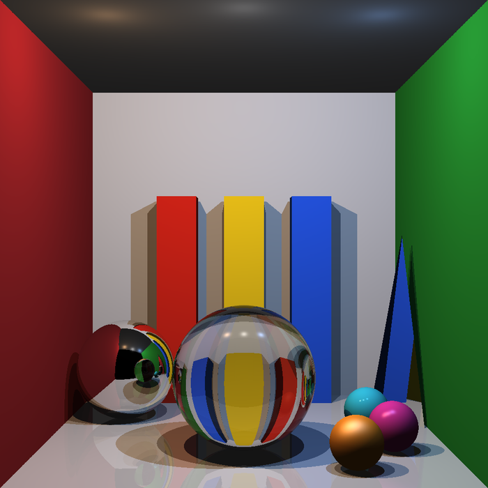
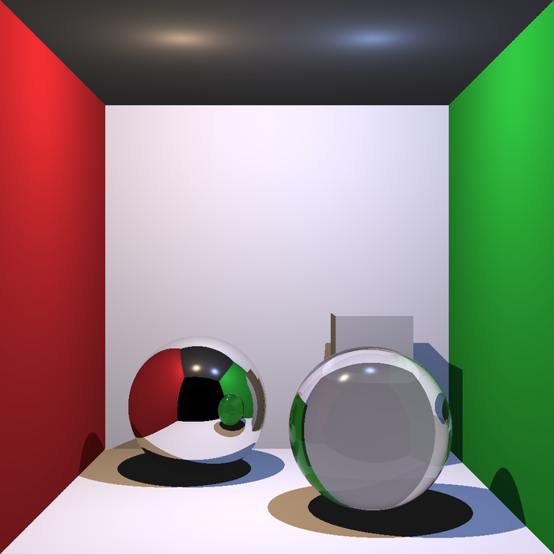
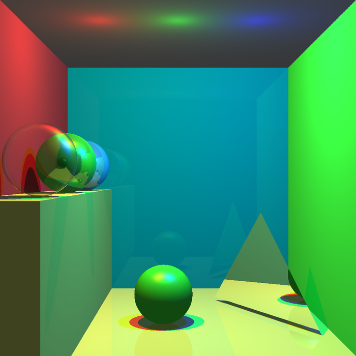

# RayTracing

[](https://github.com/PauFreixas/RayTracing/actions/workflows/ci.yml)

A small CPU ray tracer written from first principles in C++17, with an OpenGL/GLUT live preview.



*`assets/showcase.sdf`: the glass ball flips and squeezes the pillars behind it, the mirror sphere reflects the room (glass ball included), the small spheres range from broad to sharp highlights, and three coloured lights give coloured shadows.*

## Overview

This repository builds a simple ray tracer that reads a scene description from an `.sdf` file, renders the scene line by line, and displays the result in an OpenGL window. The finished image is also saved as a `.ppm` file.

## Features

- Classic (Whitted) ray tracing: Lambert diffuse and Phong highlights from every light, hard shadows, mirror reflection, and refraction with total internal reflection and Fresnel (Schlick) reflection. See [docs/shading.md](docs/shading.md)
- Spheres, boxes, triangles and convex polygons
- Uses OpenGL and GLUT/FreeGLUT for rendering
- Reads scenes from a simple text format (see [docs/scene-format.md](docs/scene-format.md))
- Saves each finished render to `results/Result<date>_<time>.ppm`
- Headless mode: renders without opening a window, for scripts and CI
- Unit tests and image regression tests, run on Windows, Linux and macOS by GitHub Actions

## Gallery

| Scene | Render |
|---|---|
| `assets/cornell_mirror_glass.sdf`: a mirror sphere and a glass sphere lit by a warm and a cool light. Notice the warm and cool tints in the shadows and the Fresnel reflection of the green wall at the glass sphere's edge. |  |
| `assets/scene.sdf` (the default scene, rendered when no file is given): the original coursework Cornell box with three red, green and blue lights. A mirror triangle on the floor, a reflective floor, and a mostly transparent sphere at the front left. |  |

## Requirements

- CMake 3.14 or newer
- A C++17-compatible C++ compiler
- OpenGL development headers and libraries
- GLUT or FreeGLUT support
- On macOS, Xcode Command Line Tools

## Installation

### Linux

Install build tools, CMake, and OpenGL/FreeGLUT development packages.

Debian/Ubuntu:

```sh
sudo apt update
sudo apt install build-essential cmake libglu1-mesa-dev freeglut3-dev mesa-common-dev
```

Fedora/RHEL/CentOS:

```sh
sudo dnf install gcc-c++ cmake freeglut-devel mesa-libGL-devel mesa-libGLU-devel
```

Arch Linux:

```sh
sudo pacman -Syu base-devel cmake freeglut mesa
```

### macOS

Install Xcode Command Line Tools and CMake.

```sh
xcode-select --install
brew install cmake
```

Optionally install FreeGLUT for better compatibility:

```sh
brew install freeglut
```

On Apple platforms, CMake will use the system OpenGL/GLUT frameworks automatically.

### Windows

Install Visual Studio 2019 or 2022 with the "Desktop development with C++" workload, or another compatible MSVC toolchain.

Install CMake if needed:

```powershell
winget install --id Kitware.CMake
```

This project will use system GLUT if found. On Windows and non-Apple systems, CMake can fetch FreeGLUT automatically if GLUT is missing.

## Build

From the project root:

```sh
mkdir -p build
cd build
cmake -DCMAKE_BUILD_TYPE=Release ..
cmake --build . --config Release
```

To build a debug configuration:

```sh
cmake -DCMAKE_BUILD_TYPE=Debug ..
cmake --build . --config Debug
```

If you are using Visual Studio, open the generated solution in `build/` and build the `Raytracer` target.

## Run

Run the executable from the `build` folder. Where it ends up depends on the CMake generator:

| Generator | Executable |
|---|---|
| Visual Studio (Windows default when Visual Studio is installed) | `build/Release/Raytracer.exe` (or `build/Debug/...`) |
| Ninja, MinGW or Unix Makefiles | `build/Raytracer` (`build/Raytracer.exe` on Windows) |

Linux/macOS:

```sh
./Raytracer                          # renders the default Cornell box
./Raytracer ../assets/scene.sdf      # renders a given scene file
```

Windows (PowerShell):

```powershell
.\Release\Raytracer.exe                # Visual Studio build
.\Raytracer.exe                        # Ninja / MinGW build
.\Raytracer.exe ..\assets\scene.sdf    # renders a given scene file
```

- With no argument, the program renders `assets/scene.sdf`. Its absolute path is built into the executable by CMake, so this works from any working directory.
- The window fills in line by line. When the render is done, the image is saved to `results/Result<YYYY_MM_DD_HH_MM>.ppm` **in the current working directory**, and the full path is printed to the console.
- Press `Esc` to close the window.
- If the scene file can't be read, the program prints `No Scene Found` and the path it tried, then exits with code 1.

`.ppm` files can be opened with GIMP, IrfanView, Photoshop or most image viewers on Linux and macOS.

### Command-line options

```
Raytracer [options] [scene.sdf]

  -s, --scene <file>    Scene to render (default: assets/scene.sdf)
  -o, --output <file>   Where to save the image, as .ppm (default: results/Result<date>_<time>.ppm)
  -w, --width <pixels>  Image width  (default: 1000)
  -h, --height <pixels> Image height (default: 1000)
      --headless        Render without opening a window
      --help            Show this help
```

### Headless mode

`--headless` renders the whole image without opening a window, saves it and exits. This works on machines with no display, such as CI servers:

```sh
./Raytracer --headless -s ../assets/showcase.sdf -o showcase.ppm -w 512 -h 512
```

## Tests

The tests use [doctest](https://github.com/doctest/doctest), which CMake downloads automatically. Build as above, then from the project root:

```sh
ctest --test-dir build -C Release --output-on-failure
```

There are two groups:

- **unit**: vector and matrix maths, reflection and refraction, ray intersection with every shape (hit, miss, grazing hit, hit from inside), and the scene reader (valid file, malformed lines, missing file).
- **image**: renders every scene in `assets/` at 128×128 and compares it with a reference image in `tests/reference/`. A small tolerance allows for floating-point differences between compilers and operating systems. Each run writes the renders and difference images to `build/test-output/`.

After a deliberate visual change, update the reference images and check them by eye before committing:

```sh
RAYTRACER_UPDATE_REFERENCES=1 ctest --test-dir build -C Release -R image     # Linux/macOS
```

```powershell
$env:RAYTRACER_UPDATE_REFERENCES = "1"; ctest --test-dir build -C Release -R image; Remove-Item Env:RAYTRACER_UPDATE_REFERENCES   # Windows
```

GitHub Actions ([.github/workflows/ci.yml](.github/workflows/ci.yml)) builds the project and runs the tests on Windows, Linux and macOS for every push to `main` and every pull request. Each run also renders the scenes headless and attaches them to the run page.

## Packaging and Shipping

- Do not commit `build/`, `Debug/`, `Release/`, or other generated build artifacts to GitHub.
- Do not include GLUT/FreeGLUT or graphics libraries as checked-in source files.
- If you want to distribute binaries, publish them as GitHub Release assets rather than storing build outputs in the repository.

## Notes

- CMake first tries to use system GLUT. If no system GLUT is available on Linux/Windows, it fetches FreeGLUT automatically.
- Rendered output (`*.ppm` and `results/`) is excluded by `.gitignore`, except the reference images in `tests/reference/`.
- On Windows, when FreeGLUT is fetched by CMake, the build copies `libfreeglut.dll` (or `freeglut.dll`) next to the executable, so it runs without any extra setup.
- The renderer draws incrementally using `glutIdleFunc` while the ray tracer computes the image.

## Files

- `src/AppMain.cpp` - application entry point: command-line options, headless mode, and the GLUT preview window (the only file that uses OpenGL/GLUT)
- `src/Raytracer.cpp` / `src/Raytracer.h` - ray tracing core: camera rays, `Trace`, `Cast`, `Shade`
- `src/World.cpp` / `src/Scene.h` / `src/Camera.h` - scene and camera data
- `src/Reader.cpp` / `src/Reader.h` - scene file parsing
- `src/Sphere`, `src/Cube`, `src/Triangle`, `src/Polygon` - geometry and ray intersection
- `assets/scene.sdf` - default Cornell box scene
- `assets/cornell_mirror_glass.sdf`, `assets/showcase.sdf` - scenes for the gallery
- `docs/scene-format.md` - scene file format reference
- `docs/shading.md` - how the shading works, with formulas and sources
- `tests/` - unit tests and image regression tests; `tests/reference/` holds the reference images
- `.github/workflows/ci.yml` - GitHub Actions build and test workflow
- `CMakeLists.txt` - project build configuration: the `raytracer_core` library, the `Raytracer` app and the `raytracer_tests` tests

## Credits

This project began as coursework for the **Image Synthesis** course of the BSc in Multimedia Engineering (video games minor) at **La Salle Campus Barcelona, Universitat Ramon Llull**.

The course provided a "toy ray tracer" skeleton: the vector, colour and image classes, the scene file reader, the object and ray-intersection framework, and the GLUT application shell.
The coursework filled in parts of that skeleton, such as the ray–box intersection and a first diffuse shader.

Everything since (the CMake build, the project layout, the documentation and later features) is tracked in this repository's git history.

## License

Released under the [MIT License](LICENSE).
