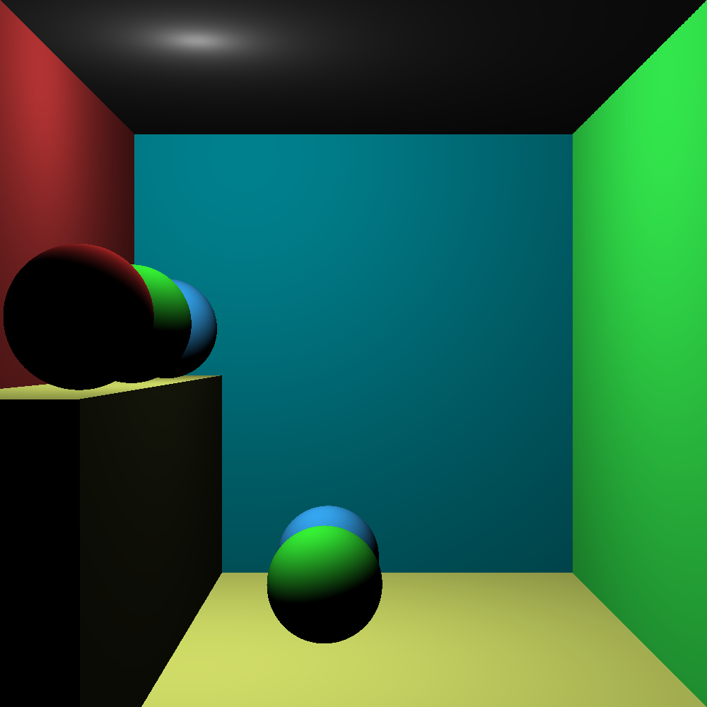

# RayTracing

A small OpenGL/GLUT-based ray tracing project written in C++. Displays a Cornell Box by default.

## Overview

This repository builds a simple ray tracer that reads a scene description from an `.sdf` file, renders the scene line by line, and displays the result in an OpenGL window. The finished image is also saved as a `.ppm` file.

## Features

- C++17 ray tracing implementation
- Uses OpenGL and GLUT/FreeGLUT for rendering
- Reads scenes from a simple text format (see [docs/scene-format.md](docs/scene-format.md))
- Saves each finished render to `results/Result<date>_<time>.ppm`

## Requirements

- CMake 3.14 or newer
- A C++17-compatible C++ compiler
- OpenGL development headers and libraries
- GLUT or FreeGLUT support
- On macOS, Xcode Command Line Tools

## Installation

### Linux

Install build tools, CMake, and OpenGL/FreeGLUT development packages.

Debian/Ubuntu:

```sh
sudo apt update
sudo apt install build-essential cmake libglu1-mesa-dev freeglut3-dev mesa-common-dev
```

Fedora/RHEL/CentOS:

```sh
sudo dnf install gcc-c++ cmake freeglut-devel mesa-libGL-devel mesa-libGLU-devel
```

Arch Linux:

```sh
sudo pacman -Syu base-devel cmake freeglut mesa
```

### macOS

Install Xcode Command Line Tools and CMake.

```sh
xcode-select --install
brew install cmake
```

Optionally install FreeGLUT for better compatibility:

```sh
brew install freeglut
```

On Apple platforms, CMake will use the system OpenGL/GLUT frameworks automatically.

### Windows

Install Visual Studio 2019 or 2022 with the "Desktop development with C++" workload, or another compatible MSVC toolchain.

Install CMake if needed:

```powershell
winget install --id Kitware.CMake
```

This project will use system GLUT if found. On Windows and non-Apple systems, CMake can fetch FreeGLUT automatically if GLUT is missing.

## Build

From the project root:

```sh
mkdir -p build
cd build
cmake -DCMAKE_BUILD_TYPE=Release ..
cmake --build . --config Release
```

To build a debug configuration:

```sh
cmake -DCMAKE_BUILD_TYPE=Debug ..
cmake --build . --config Debug
```

If you are using Visual Studio, open the generated solution in `build/` and build the `Raytracer` target.

## Run

Run the executable from the `build` folder. Where it ends up depends on the CMake generator:

| Generator | Executable |
|---|---|
| Visual Studio (Windows default when Visual Studio is installed) | `build/Release/Raytracer.exe` (or `build/Debug/...`) |
| Ninja, MinGW or Unix Makefiles | `build/Raytracer` (`build/Raytracer.exe` on Windows) |

Linux/macOS:

```sh
./Raytracer                          # renders the default Cornell box
./Raytracer ../assets/scene.sdf      # renders a given scene file
```

Windows (PowerShell):

```powershell
.\Release\Raytracer.exe                # Visual Studio build
.\Raytracer.exe                        # Ninja / MinGW build
.\Raytracer.exe ..\assets\scene.sdf    # renders a given scene file
```

- With no argument, the program renders `assets/scene.sdf`. Its absolute path is built into the executable by CMake, so this works from any working directory.
- The window fills in line by line. When the render is done, the image is saved to `results/Result<YYYY_MM_DD_HH_MM>.ppm` **in the current working directory**, and the full path is printed to the console.
- Press `Esc` to close the window.
- If the scene file can't be read, the program prints `No Scene Found` and the path it tried, then exits with code 1.

`.ppm` files can be opened with GIMP, IrfanView, Photoshop or most image viewers on Linux and macOS.

## Packaging and Shipping

- Do not commit `build/`, `Debug/`, `Release/`, or other generated build artifacts to GitHub.
- Do not include GLUT/FreeGLUT or graphics libraries as checked-in source files.
- If you want to distribute binaries, publish them as GitHub Release assets rather than storing build outputs in the repository.

## Notes

- CMake first tries to use system GLUT. If no system GLUT is available on Linux/Windows, it fetches FreeGLUT automatically.
- Rendered output (`*.ppm` and `results/`) is excluded by `.gitignore`.
- On Windows, when FreeGLUT is fetched by CMake, the build copies `libfreeglut.dll` (or `freeglut.dll`) next to the executable, so it runs without any extra setup.
- The renderer draws incrementally using `glutIdleFunc` while the ray tracer computes the image.

## Files

- `src/AppMain.cpp` - application entry point, command-line handling, GLUT callbacks and main loop
- `src/Raytracer.cpp` / `src/Raytracer.h` - ray tracing core: camera rays, `Trace`, `Cast`, `Shade`, image output
- `src/World.cpp` / `src/Scene.h` / `src/Camera.h` - scene and camera data
- `src/Reader.cpp` / `src/Reader.h` - scene file parsing
- `src/Sphere`, `src/Cube`, `src/Triangle`, `src/Polygon` - geometry and ray intersection
- `assets/scene.sdf` - default Cornell box scene
- `docs/scene-format.md` - scene file format reference
- `CMakeLists.txt` - project build configuration

## Credits

This project began as coursework for the **Image Synthesis** course of the BSc in Multimedia Engineering (video games minor) at **La Salle Campus Barcelona, Universitat Ramon Llull**.

The course provided a "toy ray tracer" skeleton: the vector, colour and image classes, the scene file reader, the object and ray-intersection framework, and the GLUT application shell.
The coursework filled in parts of that skeleton, such as the ray–box intersection and a first diffuse shader.

Everything since (the CMake build, the project layout, the documentation and later features) is tracked in this repository's git history.

## License

Released under the [MIT License](LICENSE).
